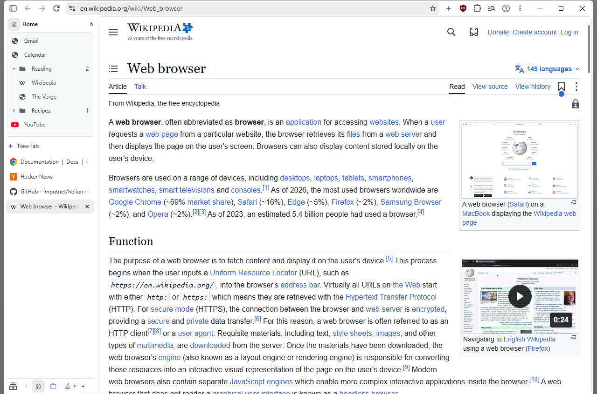
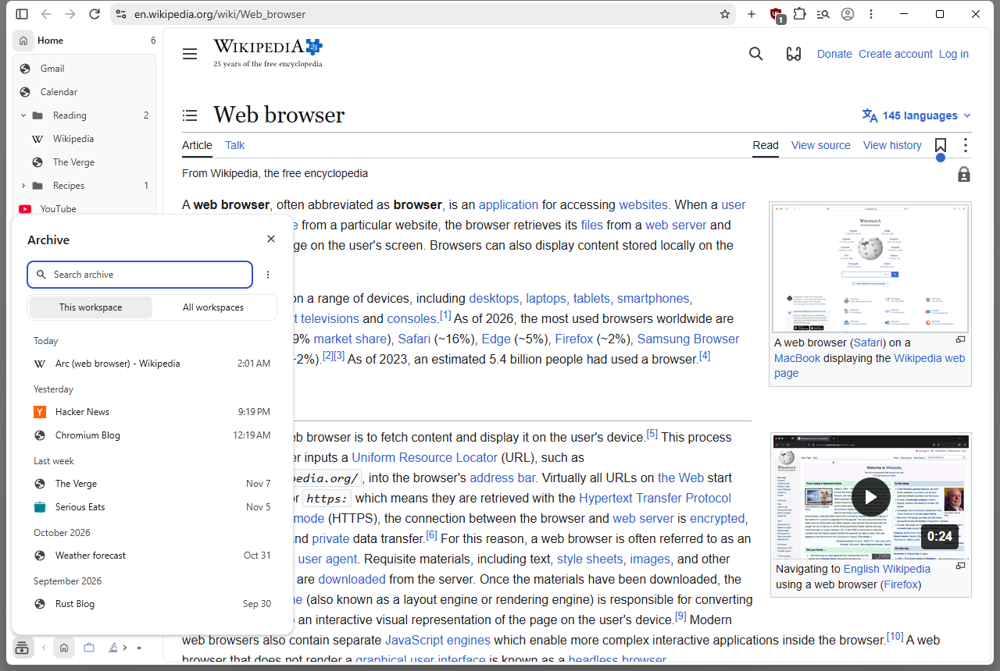
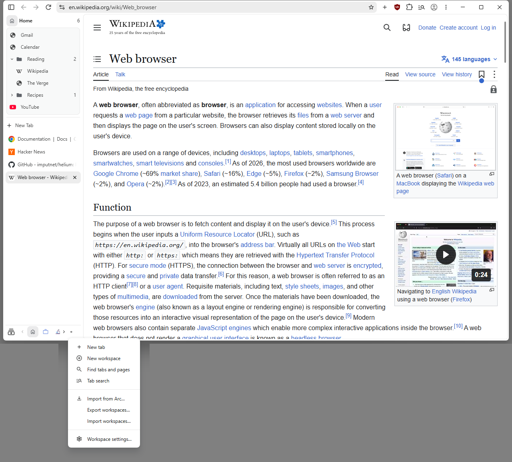

> [!WARNING]
> **This is an unofficial, personal project.** It is not made by, affiliated with or endorsed by the
> [Helium](https://github.com/imputnet/helium) team, nor by The Browser Company (the makers of Arc).
> It was built with AI assistance ("vibe coding"). Please do not report its bugs to the Helium team.

# Workspaces for Helium

Arc-style **Workspaces** (Arc called them Spaces), added to the [Helium](https://github.com/imputnet/helium)
browser as a set of patches. **Windows only**, in Helium's vertical tab layout.

<picture>
  <source media="(prefers-color-scheme: dark)" srcset="docs/home-dark.png">
  
</picture>

## Why I made this

I liked Arc's Spaces a lot. When The Browser Company stopped developing Arc, I was sad. I decided to move
to Helium, and I like it -- but I was a bit disappointed that it has no spaces. So I made them, with a few
other small features along the way, through AI-assisted vibe coding.

At first this was only for me. After a while I thought: since I have made it anyway, why not share it with
people who use Helium and also like the spaces idea? That is why there is a public release.

## What it adds

Workspaces live in normal windows with the vertical tab layout; Incognito, guest and app windows have none.
**Settings > Appearance > Workspaces** turns them off: every tab shows again, and each tab remembers its
workspace for when you turn them back on.

### Workspaces

- **Workspaces.** Several named sets of tabs in one window, each with its own name, emoji or icon, and
  colour. The sidebar shows only the workspace you are in.
- **The workspaces bar.** A row of workspace buttons at the bottom of the sidebar. Click one to switch,
  drag it to reorder, right-click it to rename, recolour, change its icon or delete it. Its **+** menu
  holds New workspace, Find tabs and pages, Import from Arc, Export / Import workspaces, and Workspace
  settings.
- **Switching.** Shift+Alt+1 to 9 jumps to a workspace and Shift+Alt+0 goes back to the one before; or
  scroll sideways over the sidebar (a mouse's side wheel or a touchpad).
- **Moving tabs.** "Move tab to workspace" on a tab's menu, or drag a tab (or several, a group, a split
  view) onto a workspace's button. A moved tab lands at the top of that workspace.
- **New windows follow you.** Ctrl+N opens on the workspace you were in.
- **Reopening keeps the workspace.** Ctrl+Shift+T and Recently Closed bring a tab, group or window back
  into the workspace it came from, with its names and order.
- **A sound badge.** A workspace's button shows a speaker (or camera, microphone, screen sharing) while
  one of its tabs that you cannot see is using it. Click it to go there.
- **Closing a tab** takes you to the tab of the same workspace you used last.
- **Site rules.** "Always open [site] in [workspace]": links to that site open in the workspace you chose.
- **Workspace tools.** Hibernate this workspace or all the others (frees memory); Bookmark all tabs;
  Make this group a workspace; Tab search lists only the tabs of the workspace you are in.

### Pinned pages (Arc's pinned tabs)

- **Pinned pages and folders** for each workspace, above its tabs. They cost nothing until you open
  them, and closing one keeps it pinned. Folders can hold folders; drag to reorder, into a folder, or a
  tab into the section to pin it.
- **Each pinned page or folder** can be renamed, given an emoji or a colour, and moved to another
  workspace. A pinned page that wandered to another address can go back, or keep the page you are on
  ("Use current page").
- **Select several** with Ctrl+click or Shift+click, then move, close, delete or drag them together.
- **Pinned split views.** Two pages side by side, kept as one pinned row, as in Arc.
- **Favorites as tiles.** "Add to Favorites" puts a page in a row of Arc-style tiles at the top.
- Counts in the section headers; a folder opens when you hover over it while dragging.

### Anchored tabs

- Anchor a tab at a page (tab menu > Anchor > "Anchor to this page"). Ctrl+W then does not close it: it
  goes to sleep and opens at its anchor page the next time. "Back to anchored page", "Anchor to this page
  instead" and "Remove anchor" change it later.

### Today tabs and the Archive

- **The Archive.** Tabs you have not looked at for a while move to the Archive by themselves (you choose
  how long, or never). Search it and restore from it, for this workspace or all of them (Shift+Alt+H).
- **Snooze tab.** Put a tab away until a time you pick; it comes back by itself.
- **Rename tab and Set emoji** give a tab your own title or an emoji.
- **Close duplicate tabs** and **Clear Today** (Shift+Alt+K) tidy up in one go.

### Finding things

- **Find tabs and pages** (Shift+Alt+F, or the + menu): one search box over the open tabs, the pinned
  pages and the Archive.
- **Ctrl+Tab** goes through tabs in the order you last used them, open pinned pages included.

### Links

- **Link preview.** "Preview link" on a link's right-click menu opens the page in a card over the one
  you are on. As in Arc, a link from an open pinned page to another site opens there too.
- **A little window for links from other apps.** A link opened from e-mail or chat opens in a small
  window, like Arc's Little Arc; "Open in main window" (or Shift+Alt+O) moves it into the main window.

### Look and settings

- **Workspace settings...** (the + menu): when tabs move to the Archive, tab style (compact or roomy),
  smooth scrolling in the tab list, and a sidebar as wide as the window allows.
- **Toolbar buttons where you want them.** Put any toolbar button on either side of the address bar, by
  dragging it in the toolbar or in Settings. The New tab button works in every layout.
- **Zen mode's floating sidebar** can be resized.
- The whole look follows Helium's style, with Arc's feel.

### Coming from Arc

- **Import from Arc...** (the + menu) brings in your Arc spaces as workspaces, their pinned tabs and
  folders as pinned pages, favorites, split views, and open tabs (asleep, so it is quick even with
  thousands). Running it again later adds only what is new, into a "New from Arc" folder.
- It reads Arc's own files on your PC, so **import before you uninstall Arc**.
- Arc's archive (its auto-closed tabs) is not part of it. With Python installed and this browser closed,
  [local/import-arc-archive.py](local/import-arc-archive.py) brings it over.

### Moving to another PC

- **Export workspaces...** (the + menu) saves your workspaces, pinned pages and Archive to one file;
  **Import workspaces...** on the other PC brings them in (a copy of what was there is saved first). A
  .csv list of the pinned pages is there too, for a spreadsheet.

### Keyboard shortcuts

| Keys | Does |
|---|---|
| Shift+Alt+1 ... 9 | go to workspace 1 ... 9 |
| Shift+Alt+0 | back to the workspace you were in before |
| Shift+Alt+Left / Right | the previous / next workspace |
| Shift+Alt+Up / Down | move the workspace you are in one place earlier / later in the bar |
| Shift+Alt+S | new workspace |
| Shift+Alt+D | pin the page in front, or unpin it |
| Shift+Alt+F | Find tabs and pages |
| Shift+Alt+H | the Archive |
| Shift+Alt+K | Clear Today |
| Shift+Alt+O | in the little window: move its page into the main window |
| Ctrl+Tab | the tab you used last |

## Install

Windows 10 or 11, 64-bit.

**Install [official Helium](https://helium.computer) first: strongly recommended.** This browser runs on its
own, but you need official Helium to tell whose bug a problem is ([Reporting a bug](#reporting-a-bug), step 1),
and for the sites where security fixes matter most ([Updates and security](#updates-and-security)).

1. Download `workspaces-for-helium_<version>_x64-setup.exe` from the [Releases](../../releases) page.
2. Optional, to check the file is the one I built: in PowerShell, run
   `Get-FileHash .\workspaces-for-helium_<version>_x64-setup.exe` and compare the result with
   `SHA256SUMS.txt` on the same release (capital or small letters do not matter).
3. Run it. The installer and the browser are **not code-signed** (signing costs money every year), so
   Windows warns you:
   - SmartScreen ("Windows protected your PC"): **More info > Run anyway**.
   - Smart App Control (Windows 11) blocks unsigned programs and has no "run anyway"; where it is on,
     this installer cannot run.

It installs next to official Helium without touching it: each keeps its own profile (tabs, history,
sign-ins). Your data lives in `%LOCALAPPDATA%\Helium Workspaces\User Data` (the project's first name; the
folder keeps it so that updates move nothing).

## Updates and security

- The browser does **not** check for updates by itself, and adds no calls home. Watch this repository's
  Releases page (GitHub's Watch > Custom > Releases) to hear about new versions.
- I rebuild on top of each new Helium release, so security fixes reach this browser **later than official
  Helium**: usually within 7 days. When a Helium release fixes a serious security bug, I release that
  first. If that delay matters to you (banking, work accounts), use official Helium for those.
- The version number says what a release is built on. In `1.21.157.00`: `1` is this project's public series,
  `21` is the Helium release (0.**21**.1.1), `157` is the Chromium version underneath (**157**.0.8103.38), and
  `00` counts the releases on that base, 00 first. When the middle numbers change, the browser underneath moved
  to a newer Helium or Chromium; when only the last one does, it is a fix on the same base. Each release's notes
  name the exact Helium and Chromium versions ("Built on ...").

## Reporting a bug

1. **Check it is mine.** Try the same thing in official Helium. If it happens there too, it is Helium's
   bug: report it to Helium from official Helium, without mentioning this project.
2. **Open an issue** on this repository's [Issues](../../issues) page with:
   - the version (Windows Settings > Apps > Installed apps shows it under Workspaces for Helium);
   - your Windows version (Windows 10 or 11);
   - what you did, step by step; what you expected; what happened instead;
   - a screenshot or a short screen recording, if it shows the problem.
3. **Keep your private things out of it.** Crop screenshots so they show no tabs, addresses or accounts
   you would rather keep to yourself, and never attach files from your profile folder.
4. **A security problem** (something a web page could use against you): please do not open a public
   issue. Use the private **Report a vulnerability** button on this repository's [Security](../../security) tab.

I read every report, but I fix what I can, when I can (see below).

## What to expect from me

- **Windows only.** I am a Windows user and not a programmer, and I am lazy by nature, so I will not make
  a macOS or Linux version. You are welcome to, and I encourage it: build it in your own repository. I will
  not merge it here.
- Bug reports are welcome. Feature requests too, but I may not answer one that I am not interested in.
- **Small changes on purpose.** I change as little of Helium as I can, so each new Helium release
  reaches you quickly. Anything that needs large changes to Chromium itself, like most of the Known
  issues below, is not planned.
- I will **not** try to merge this into Helium. Helium does not accept vibe-coded contributions: its
  [AGENTS.md](https://github.com/imputnet/helium/blob/main/AGENTS.md) says *"This project does not accept
  vibe-coded contributions."*, and its [CONTRIBUTING.md](https://github.com/imputnet/helium/blob/main/CONTRIBUTING.md)
  bans AI-written pull requests and AI "slop".
- If the Helium team ever adds workspaces to Helium itself, I may stop updating this, as it will no longer
  be needed. So if you see new releases here, you know I am still using it and Helium still has no
  workspaces out of the box.

## Your data and privacy

- Everything stays on your PC, in the profile folder above. Nothing of this project is sent anywhere; all
  other behaviour is Helium's ([Helium's privacy policy](https://github.com/imputnet/helium-legal/blob/main/privacy.md)).
- Uninstalling (Windows Settings > Apps) keeps your data unless you tick **"Also delete my Workspaces for
  Helium data"**.
- **No real browsing in this repository.** I tested on my own PC, so before publishing I went through
  every file, every test result and every screenshot for traces of my own browsing: history, links,
  sign-ins. I replaced them with made-up data and deleted the rest; the test profiles hold made-up pages
  only. This public repository starts from that cleaned copy, without the old history. If you still spot
  something that looks personal, open an issue with the file name only, not what it says.

## Known issues

- English only.
- Dragging the sidebar's edge sticks near its default width (Helium's own behaviour).
- After an update, the sidebar can come back once at its default width when the browser reopens your
  windows ("Continue where you left off"). Drag its edge back once and it stays. Fixed in the next release.
- Start the browser from its Start menu shortcut, or a taskbar pin made from it. Started as a bare
  `chrome.exe` while official Helium is open, it opens official Helium's window instead.
- Helium's "back to opener" (Back on a tab opened from a link closes it) stays on; an anchored tab
  ignores it.
- All workspaces share one profile: the same sign-ins, cookies and history. Arc can give a space its own
  profile; Chromium has no way yet to keep one tab's storage apart. For separate sign-ins, use a second
  browser profile (each profile has its own workspaces).
- No sync: your workspaces stay on this PC. **Export workspaces...** and **Import workspaces...** move them.
- An open tab lives in one window. Arc shows the same tab in every window; here each window has its own
  open tabs.
- Arc's Boosts, Easels and Notes have no counterpart here; Import from Arc skips them, and any other
  Arc-only page.
- Arc splits of three or four pages come in as separate pages: a split here holds two, as in Chromium.
- With a screen reader running, importing thousands of Arc tabs takes much longer.

## Building it yourself

Follow [helium-windows](https://github.com/imputnet/helium-windows) at the Helium version a release names
("Built on Helium ..."), with three changes to your clone of it: apply
[local/helium-windows-build.py.diff](local/helium-windows-build.py.diff) (finds ATL in newer Visual Studio
installs), point its `helium-chromium` submodule at this repository
(`git submodule set-url helium-chromium <this repository's URL>`), and check that submodule out at the
release's tag (for example `v1.21.157.00`). Helium's own build step renames "Chromium" to "Helium" in the
browser's texts; a `build.py --dev` build skips it, so run `utils/name_substitution.py --sub` after the
patches. [local/README.md](local/README.md) explains the helper scripts;
the `check-*.ps1` tests assume my folders. Never set `WINSPARKLE_ED_KEY` or `WINSPARKLE_AUTHENTICODE_ORG`, and never run
the build's own `mini_installer.exe` on a PC with official Helium installed.

## Source code, licence and credits

- Licence: **GPL-3.0**, the same as Helium. Each release links the exact commit it was built from.
- Built on [Helium](https://github.com/imputnet/helium) by imputnet, which builds on
  [ungoogled-chromium](https://github.com/ungoogled-software/ungoogled-chromium) and Chromium.
- The patches are in [patches/local/workspaces/](patches/local/workspaces/); the design is in
  [helium-workspaces-design.md](helium-workspaces-design.md).
- Written with AI assistance ([Claude Code](https://claude.com/claude-code)); I tested every feature by hand
  on my own PC before releasing it.
- "Helium" is the name of imputnet's browser; this project uses it only to say what it is built on. "Arc"
  belongs to The Browser Company. The icon is this project's own.
